<picture>
  <source media="(prefers-color-scheme: dark)" srcset="assets/banner-dark.svg">
  
</picture>

Nearly four years building computer vision, agentic AI and the products around them. Most of that work sits in private and organization repos, so the graph below says little. This is what is in them.

| | |
|:--|:--|
| **[Boon AI](https://getboon.ai/)** *Full-time, now* | Open-vocabulary symbol takeoff: counts symbols the model was never trained on, from a single example a user points at. Electrical takeoff and branch-circuit inference on dense plan sets. A voice agent that calls drivers and turns the call into structured data. |
| **[SentBe](https://corporate.sentbe.com/sentbe?lang=en)** *Full-time, previously* | Internal operations platform for a Singapore remittance company. Daily transaction forecasting, balance tracking and fund scheduling for FX operations, plus an assistant for navigating internal company data. |
| **[Marrow](https://www.marrow.works/)** *Side project* | Memory for AI agents. Rust, MCP, open source. A 75-run benchmark measured 2.1x less context per turn at 1,000 facts (p = 0.002). |
| **[Spinal Cloud](https://spinal.cloud/)** *Side project* | The hosted relay behind Marrow, so a team can share one memory across machines without running the infrastructure themselves. A twelve-crate Rust workspace covering auth, billing, the relay bus, and a hash-chained journal. |
| **[Stuart](https://www.stuartdesk.com/)** *Side project* | A Mac app for customer calls. When someone asks about your product, it answers from your code, docs and past calls, with sources. |
| **[Halftime](https://github.com/aryawidjaja/halftime)** *Side project* | A Claude Code plugin. When you hit your usage limit, it opens a short course on what Claude just did in your project. |
| **[Aimé](https://aime.med/)** *Side project* | Real-time clinical speech: diarization, live transcripts, generated notes. Clinicians reported up to 10x less time charting. |
| **[Buatin.mba](https://buatin.mba/)** *Side project* | Household finance app on Next.js and Supabase. Row-level security throughout, a background worker for email and document jobs, and Redis for queue wake-ups and distributed rate limiting. |
| **[Hit the Corner](https://hitthecorner.lol/)** *Side project* | The fun one. The internet's shared logo screensaver, with Dodo Payments behind it. |
| **[Mata Garuda](https://www.matagaruda-eci.com/)** *Side project* | 27-class road damage detection at over 80% accuracy. Spatial queries cut from 30s to under 1s across 50,000 records. |

### Weekends

Things I got curious about and ran to find out. All simulation or public data, on a laptop.

| | |
|:--|:--|
| **[Flight-test the fly](https://github.com/aryawidjaja/flight-test-the-fly)** [replay](https://fly.aryawijaya.com) · [preprint](https://www.preprints.org/manuscript/202610.1232/v1) | Can a fruit fly's wiring diagram, run as a spiking network, keep a simulated Cessna 172 straight in turbulence? |
| **[Mutant Brain Drone](https://github.com/aryawidjaja/mutant-brain-drone)** | A small drone that finds a target and flies home with no GPS and no map, steered by models of bee, ant and fly circuits. |
| **[Silent Flock](https://github.com/aryawidjaja/silent-flock)** | A drone flock with no radio, where the drones only see each other and most GPS receivers are being spoofed. Who do the rest follow? |
| **Inner Voice Check** *private for now* | Does a public brain-to-text decoder, trained on attempted speech, also pick up imagined speech from the same person? |
| **Virtual Neurologist** *private for now* | Can an LLM work out which part of a simulated fly brain was switched off by running its own experiments? |
| **[Flying Rocket Roadster](https://github.com/aryawidjaja/rockster-car)** *opening soon* | How high can a road car on cold-gas thrusters hop and still land, once the tanks cool down as they empty? |

[Marrow](https://github.com/aryawidjaja/marrow) · [LinkedIn](https://www.linkedin.com/in/mutaqinaryawijaya) · [ORCID](https://orcid.org/0009-0008-5199-2413) · [mutaqin@aryawijaya.com](mailto:mutaqin@aryawijaya.com) · Open to part-time senior work, remote
